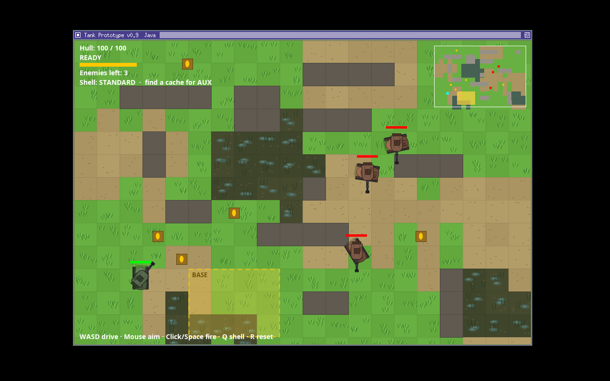

# Tank Prototype (Java)

A small, simple top-down tank game prototype inspired by War Thunder ground vehicles.
Pure JDK (Swing/Java2D) — no external dependencies, no Gradle/Maven needed.



## Run

On Linux / macOS:

```bash
# from this directory
./run.sh
# or manually:
javac -d out $(find src -name '*.java')
java -cp out tank.TankGame
```

On Windows:

1. Install a JDK (21 or newer — Eclipse Temurin works).
2. Copy this whole folder to the Windows machine.
3. Double-click `run.bat`, or from `cmd` in this folder run:

```bat
run.bat
```

The game is plain Java/Swing with no native code, so the same source runs
on Windows unchanged. `run.bat` does the Windows equivalent of `run.sh`:
it finds the sources, compiles them into `out`, and launches the game.
For a single double-clickable `.exe` with the Java runtime bundled, the
JDK's `jpackage` tool can build one — that step has to run on Windows.

## Controls

- **W / S** — drive forward / reverse
- **A / D** — turn hull left / right
- **Mouse** — aim turret
- **Left-click / Space** — fire the currently selected shell (reload from config, 1.2s by default)
- **Q** — switch between the standard shell and the aux shell (if you carry one)
- **1 / 2** — select standard / aux shell directly
- **R** — reset after destruction (new random layout, unless a seed is set)
- **Esc / close window** — quit

## Item caches and the aux shell

Orange caches are scattered around the map. Drive within pickup range and the
cache is consumed: you gain **one** aux shell. It's a single shot — slower and
heavier than the standard shell (170 px/s, 68 damage before armour, vs 220 px/s
and 34). Load it with **Q** or **2**, fire it, and the gun automatically falls
back to the standard shell. You can carry several aux shells if you find
several caches. Cache locations show as orange dots on the minimap.

## Configuration

Edit `config.properties` in this folder, then relaunch. Values are read once at startup.
Bad or out-of-range values fall back to defaults with a warning in the terminal.

| Key | Default | What it does |
| --- | --- | --- |
| `worldWidth` / `worldHeight` | 1920×1280 | Full map size; the window shows a 960×640 camera view |
| `enemyCount` | 3 | AI tanks spawned (0–12) |
| `obstacleCount` | 12 | Random cover blocks placed (0–30) |
| `cacheCount` | 5 | Item caches placed (0–30) |
| `baseWidthTiles` / `baseHeightTiles` | 4×3 | Yellow base safe-zone size, in 48px tiles |
| `playerReloadSeconds` | 1.2 | Seconds between your shots — lower fires faster |
| `enemyReloadSeconds` | 2.1 | Seconds between enemy shots |
| `shellSpeed` | 220 | Standard shell velocity, px/s |
| `auxShellSpeed` / `auxShellDamage` | 170 / 68 | The one-shot cache shell |
| `playerSpeed` | 110 | Your hull speed, px/s |
| `enemySpeed` | 55 | Enemy hull speed, px/s |
| `playerHealth` / `enemyHealth` | 100 | Hit points |
| `shellDamage` | 34 | Standard shell damage before armour multiplier |
| `grassMovementScalar` | 1.0 | Tank speed multiplier while on grass |
| `sandMovementScalar` | 1.0 | Tank speed multiplier while on sand (same as grass by default) |
| `swampMovementScalar` | 0.35 | Tank speed multiplier while in a swamp — very slow |
| `randomSeed` | *(empty)* | Empty = new layout each run; a number = same layout every time |

## Base safe zone

Each world gets one yellow **BASE** zone (4×3 tiles by default), placed at
random and fixed for that world. It is a truce area for everyone:

- A tank inside the base cannot be hurt.
- A shot fired by a tank inside the base cannot hurt anyone.
- The shell still flies and is consumed on impact — it just deals no damage.

Obstacles and caches are never placed inside it, and it shows on the minimap.

## What's in v0.9

- Square turrets: boxy turret body with flat sides, a square mantlet and
  hatch, and panel lines, replacing the tapered v0.8 turret
- The yellow base safe zone described above

- More grounded tank design: longer tapered hulls in muted olive and
  rust-brown with camouflage blotches, segmented tracks, side skirts,
  and low turrets with stowage bins and a single hatch. The bright
  accent stripes, cupola, and antenna from v0.7 are gone.

- Simpler grass: bright flat tiles with clean three-stroke tufts and a
  faint checker between neighbours, inspired by classic top-down
  handheld RPG grass (original code and colours)
- Upgraded tank designs: angular hulls with sloped glacis and tracks,
  faceted turrets with mantlet and muzzle brake (restyled in v0.8)
- Windows launcher (`run.bat`) — same Java source, no changes needed

- Per-terrain movement scalars in config: grass 1.0, sand 1.0, swamp 0.35
  by default. The scalar of the tile a tank is on multiplies its speed,
  for both the player and the AI.
- New Swamp terrain: murky patches with dull pools and reeds. Very slow
  to cross (35% speed by default), but not blocking.
- Terrain tiles: the world is a 48px tile grid of grass, sand, and swamp.
  Grass and sand move at normal speed by default; swamp is slow. Each
  type has its own look, and terrain also shows on the minimap.
- Tile-sized obstacles: cover blocks are aligned to the tile grid and
  come in mixed footprints — 1×1, 2×1, 1×2, 2×2, 3×1, up to 4 tiles —
  always including at least one 1×1 block

- A 1920×1280 world (configurable) with a camera that follows your tank,
  plus a minimap showing obstacles, caches, enemies, and your current view
- Item caches that grant a one-shot aux shell, switchable with Q / 1 / 2
- Shells are real objects in flight: created at the muzzle with a velocity,
  updated every frame, and removed when they hit a tank, an obstacle, or
  leave the world — they are not hitscan
- Player tank with separate hull + turret rotation (like a real tank)
- Collision checking: hulls can't drive through obstacles, the map edge, or each other
- Random cover obstacles every run — tile footprints and positions vary;
  spawn areas are kept clear so nobody starts stuck in a wall
- Config file for world size, enemy/obstacle/cache counts, fire rate, speeds, health and damage
- AI enemy tanks that patrol, hold position near the player, aim and fire with inaccuracy
- Armour-ish damage: front hits do less damage than side/rear hits
- Health, reload indicator, win/lose + reset

## Roadmap ideas

- [ ] Smarter enemy navigation (pathfinding around obstacles) and target leading
- [ ] Penetration vs armour thickness, ricochets, module/crew damage
- [ ] Track/suspension feel, acceleration & terrain speed differences
- [ ] Sound, particles, screen shake
- [ ] Multiplayer netcode (later — big step)

## Structure

- `config.properties` — gameplay tuning, read at startup
- `run.sh` — Linux/macOS launcher; `run.bat` — Windows launcher
- `src/tank/TankGame.java` — entry point + game loop + camera/rendering + input
- `src/tank/GameLogic.java` — headless-testable game state & simulation step
- `src/tank/GameConfig.java` — config file loading and validation
- `src/tank/SmokeTest.java` — headless simulation test (`java -cp out tank.SmokeTest`)
- `src/tank/CollisionTest.java` — headless hull-collision test (`java -cp out tank.CollisionTest`)
- `src/tank/ShellAndCacheTest.java` — shell flight + cache pickup test (`java -cp out tank.ShellAndCacheTest`)
- `src/tank/TerrainTest.java` — terrain + tile-obstacle test (`java -cp out tank.TerrainTest`)
- `src/tank/BaseZoneTest.java` — base safe-zone test (`java -cp out tank.BaseZoneTest`)
